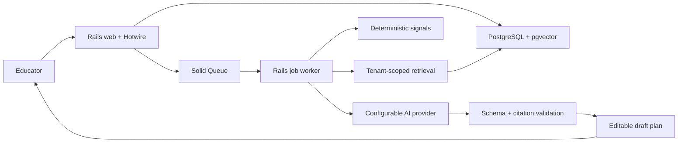

# Architecture overview

LearningSignal starts as a modular Rails monolith. The web application, job worker, and shared domain code ship as one image while PostgreSQL, MinIO, and Mailpit run as supporting local containers.

## Investigation sequence

1. Deterministic rules identify a measurable academic change and create an idempotent signal.
2. A teacher explicitly starts an investigation.
3. A background job gathers recent performance evidence and retrieves curriculum chunks within the same tenant and learning objective.
4. The configured provider returns an observation and three actions under a strict schema.
5. The grounding validator rejects missing or unknown citations before persistence.
6. The teacher edits, approves, or rejects the draft. The original AI snapshot remains available.
7. Material transitions are appended to the organization's hash-chained audit history.

## Boundaries

- `Signals` is deterministic and explainable; it never calls an AI provider.
- `Curriculum` validates uploads, extracts PDF text with Poppler, preserves page locators, and computes embeddings in bounded batches.
- `StudentDataImports` validates stored CSV sources, previews row-level errors, and applies tenant-scoped roster, mastery, assessment, or response changes atomically.
- `AssessmentAttempt` totals and objective mastery are calculated from stored answer keys and raw responses; imported score totals are never trusted.
- `Retrieval` is scoped by organization and learning objective before similarity ranking.
- `Ai` exposes a small `generate`/`embed` interface, keeping provider payloads out of domain services.
- `Investigations` owns workflow state and grounding validation.
- `Audit` records security- and decision-relevant transitions.
- Pundit policies constrain application reads and writes to a user's organizations.

Solid Queue and Solid Cable use separate PostgreSQL databases in development, preserving an easy path to independent scaling without introducing additional infrastructure during the local milestone.
